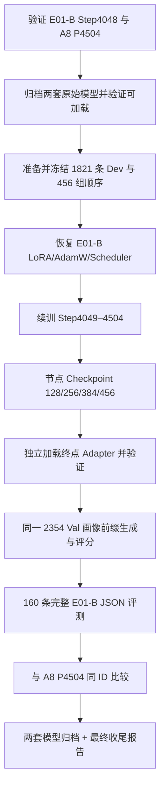

# E01-B Full：Train→Dev 续训、Val 同集对比与最终模型归档（Codex 执行方案）

> **执行状态：已完成（2026-11-08）。** E01-B 续训至 Global Step 4504、四个全状态检查点、独立 Adapter 重载、2,354 条同集 Val 对照与固定 160 条完整 JSON 检查均已完成。结果为 E01-B 画像 Micro-F1 `0.4014`、A8 P4504 `0.4678`；两套模型均保留，不自动选型。详细数据、Hash、限制与复现命令见[最终对照与收尾报告](../experiments/E01-B_TrainDev_Val_最终对照与收尾.md)。

## 一、目标与执行范围

本任务只完成现有 **E01-B Full** 的收尾工作：从其已经训练完成的 **Train Step 4048** 恢复完整状态，继续在符合原 SFT 协议的 **1,821 条 Dev** 上训练一轮，得到 **E01-B Train+Dev Step 4504**；随后用与 **A8 P4504** 相同的 **2,354 条 Val ID** 评测画像，生成最终对照报告，保存两个候选模型并结束本阶段。

不从 Base 重训 E01-B；不修改原 P0/F2/T1、原有 Gold、标签枚举及训练目标；不开展 Replay、新 Prompt、新 Loss 或新的超参数搜索；不合并不同模型权重。**所有旧 Run、原始 Adapter 与 Checkpoint 只读，新增独立 Run；无需中途人工批准，工程门禁通过后一次性执行至最终报告。**

### 已核对的来源和现状

| 对象 | 原始身份与位置 | 状态/作用 |
|---|---|---|
| E01-B Full Train | `outputs/training/E01-B-FULL-20261028-133805/` | 历史报告记录已完成 16,192 条 Train、4048 steps，保留 `trainer/checkpoint-4048`、`adapter/` |
| E01-B 训练 Checkpoint | `outputs/training/E01-B-FULL-20261028-133805/trainer/checkpoint-4048/` | 应含 Adapter、`optimizer.pt`、`scheduler.pt`、`trainer_state.json`、`rng_state.pth`、`checkpoint_manifest.json`；以**本地真实文件和 Manifest**为准 |
| E01-B 历史 Dev | 1,833 条，画像 Micro-F1 0.4223 | **仅背景参考**，不能与 A8 Val 直接比较 |
| Dev SFT | `data/processed/sft/v1/dev.jsonl` | 有效 1,821 条；另 12 条依 D0.4.2 预算规则排除 |
| A8 P4504 | `outputs/training/E03-A8-DEVFT/P/E03-A8-DEVFT-20261108-02-PDEV-1EPOCH/trainer/checkpoint-0456/` | 已完成 Train+Dev；保留原模型、已有 Val 预测与评分 |
| A8 Val 评测 | `outputs/evaluation/e03_a8_devft_v1/E03-A8-DEVFT-20261108-02-PDEV-1EPOCH/` | 2,354 条，33 标签画像 Micro-F1 0.4678；用作同集对照 |

当前参考仓库：`LIZZYGREAT/EmotionCompany` 分支 `exp/e03-a8-generative-specialist`，核对提交 `d55510aafb85feb319ccf7970c55fa84a9a8c94e`。开始执行时记录实际 HEAD、工作区和实际文件 Hash；如分支有更新，以代码和产物真实身份重新核对，不假定 GitHub 中包含本机 `outputs/` 文件。

## 二、先锁定、备份旧模型：任何训练之前完成

### 1. 检查 E01-B Step 4048

- 对照 E01-B 的 `manifest.json`、`config_snapshot.yaml`、`training_evidence.json`、`reload_check.json`、`trainer/checkpoint-4048/checkpoint_manifest.json`：验证 Run `passed`、全局步数 4048、原始训练样本数 16192、Base 权重 SHA、独立 Adapter 重载状态和训练配置身份。
- 遍历 Checkpoint Manifest 列出的**全部文件**，核对大小与 SHA-256；必须具有 Adapter 权重、AdamW、Scheduler、Trainer State、RNG 等恢复文件。确认 `trainer_state.global_step=4048`；若 Checkpoint 不完整或身份不匹配，**停止训练**，不可通过只读取 `adapter/` 权重伪装为优化器状态连续恢复。
- 读取原 Run 的 `config_snapshot.yaml` 获得已经批准的实际训练参数。仓库中的 `configs/training/e01_b.yaml` 仍含 `null`/草案字段，**不得直接拿它作为实际续训参数来源**。
- 确认原始 E01-B 最终 `adapter/` 与 `checkpoint-4048` 的 Adapter 加载行为/参数身份相符。确认本地 Base 的文件身份与历史记录 `005d20550c04f4e246e5b434448786b44a0196b47d758d0acc77aba279e5bbc5` 相符。

### 2. 制作不可覆盖归档

在 `outputs/final_candidates/` 建立只读候选目录，至少保留：

```text
outputs/final_candidates/
├── E01-B-TRAIN4048/
│   ├── adapter/                # 原 E01-B 完整 Adapter 拷贝
│   ├── checkpoint-4048/       # 含 optimizer/scheduler/RNG 的独立副本
│   ├── source_manifest.json   # 来源 Run、权重/Base/配置 SHA、全局步数
│   └── SHA256SUMS.txt
└── A8-P4504/
    ├── adapter/                # 从最终 checkpoint 中提取/复制可推断 Adapter
    ├── checkpoint-0456/       # 若本地空间允许，保留完整恢复状态副本
    ├── source_manifest.json
    └── SHA256SUMS.txt
```

拷贝使用保留原文件的方式，不使用指向可能被删除的临时路径的符号链接；目标已存在则校验，不静默覆盖。备份后计算**副本** Hash，独立加载两套 Adapter 并验证固定 Prompt 的确定性下一 Token（至少 E01-B 要求与原保存模型一致）；确认实际可恢复后才放行训练。如果空间不足，必须先完成两个 Adapter 的持久副本及身份校验，E01-B 完整 Checkpoint 副本优先于非必要的中间缓存，不能删除原件腾空间。Base 模型共享只读文件，登记其逐文件身份，不强制复制数 GB 的 Base 权重。

## 三、E01-B DevFT 数据与训练协议

### 1. 数据准备

- 使用已经存在的 `data/processed/sft/v1/dev.jsonl`，依据 D0.3 / D0.4.2 / D0.4.3 Manifest 核验来源、1821 个唯一有效样本 ID、每条与对应 Dev Gold 的精确映射及 12 条排除原因。
- **保留 E01-B 原有完整 Completion**：依次监督 `emotion_label`、`user_profile`、`response_text`、`memory_refs` 所需的 F2 JSON Completion，而不是 A8 的三行 `Personality=` 文本；Prompt 使用 E01-B 原 P0，历史使用 T1，序列预算保持 P=1280、S=2048，`enable_thinking=False`。
- 复用现有预编码 `input_ids / labels / attention_mask / prompt_length / completion_length` 和 `SFTDataCollator`，验证 Prompt 标签全为 `-100`、Gold Completion 全监督、EOS 受监督，超过预算的样本未重新纳入。
- 固定 Seed=42，对 Dev 的 1821 个唯一 ID 洗牌一次，不放回消费；`microbatch=1`、梯度累积 4，故共 `ceil(1821/4)=456` 个新增 Optimizer Steps；前 455 步各 4 条，最后一步 **1 条**，梯度分母必须使用实际组大小 1。将真实 456 组样本 ID 固化 `sample_order.jsonl` 并哈希。

### 2. 从历史 E01-B Trainer 状态恢复

这一环节是本任务的核心，**不得直接将 `trainer.train(resume_from_checkpoint=旧CKPT)` 与新 Dev Dataset 搭配后假定已经正确续训**：Trainer 会依据保存的 `global_step` 和新 DataLoader 长度处理跳过逻辑，可能遗漏 Dev 样本或直接判定任务结束。

推荐用独立的 **DevFT 训练循环**，参照 `scripts/e03_a8_devft.py` 的阶段、保存和验证组织，但使用 E01-B 原完整 Causal LM Completion Loss：

1. 读取旧 `config_snapshot.yaml`，构建同一 Base/NF4/BF16、同一 LoRA r=8、alpha=16、dropout=0、七个 target modules、同一 P0/F2/T1 输入。加载原 `checkpoint-4048` 的 LoRA 权重并设为可训练，验证原始 Adapter 权重指纹、可训练参数名和 dtype。
2. **重建原 Trainer 的 AdamW 参数分组和参数顺序**（可复用现有 Trainer 的 optimizer 构造逻辑），不要想当然建立只有一个参数组的新 AdamW。读取旧 `optimizer.pt`，检查原/新参数组数、每组参数数量、张量形状、优化器状态、`step=4048`；原始优化器分组不兼容则阻断，不静默丢弃动量或重新初始化。
3. 恢复原 constant scheduler (`scheduler.pt`) 并核对 `last_epoch=4048`；读取原 RNG 状态作为恢复依据，再为新的 Dev 独立洗牌按配置记录 Seed=42 的状态处理。保留原 LR=1e-4、weight decay 和梯度裁剪口径；记录是否与原快照完全一致。
4. 对 Dev 每条预编码训练样本，执行 `model(input_ids, labels, attention_mask).loss`（原始 Completion-only CE），`loss / actual_group_size` 反向传播；每组消费结束才 clip / `optimizer.step()` / `scheduler.step()` / `zero_grad()`。**不能套用 A8 专用三行输出 Loss，也不能悄悄改成新任务。**
5. Global step 从 **4049** 增长到 **4504**，新 Dev-local step 从 1 到 456；每组记录真实 ID、GPU 时间、Loss、有限梯度与参数更新事实；到 128/256/384/456 保存独立 Checkpoint。每份包含 Adapter、Optimizer、Scheduler、RNG、Trainer State、Manifest、已消费 ID 哈希。每个保存点的输出互不覆盖。
6. 在 456 完成时验证：`1821/1821 unique Dev IDs` 消费且无重复；`global_step=4504`；全部参数更新是 LoRA 且 Base 未变；终点 Adapter **独立加载**后与保存前固定 Prompt 的 Token IDs 一致；Checkpoint 所有文件 Hash 通过。

**伪代码（执行顺序）**：

```python
parent = verify_original_e01_checkpoint(step=4048)
archive_original_e01_and_a8()
rows = load_verified_e01_sft_dev_rows(count=1821)
schedule = freeze_one_epoch_schedule(rows, seed=42, group_size=4)
model = load_base_and_trainable_e01_adapter(parent)
optimizer, scheduler = reconstruct_exact_e01_optimizer_and_scheduler(parent, model)
verify_parent_step_optimizer_groups_dtype_and_weights(parent, model, optimizer, scheduler)

for dev_step, sample_ids in enumerate(schedule, start=1):
    optimizer.zero_grad(set_to_none=True)
    for sample_id in sample_ids:
        batch = load_preencoded_full_json_sft_row(sample_id)
        loss = model(**batch).loss
        (loss / len(sample_ids)).backward()
    validate_finite_gradients()
    clip_grad_norm_using_parent_config()
    optimizer.step()
    scheduler.step()
    record_step(global_step=4048 + dev_step, sample_ids=sample_ids)
    if dev_step in (128, 256, 384, 456):
        save_complete_immutable_checkpoint(dev_step, global_step=4048 + dev_step)

verify_exact_dev_coverage_and_independent_reload()
```

运行目录建议：

```text
outputs/training/E01-B-DEVFT/E01-B-DEVFT-FINAL-<run-id>/
  manifest.json
  config_snapshot.yaml
  sample_order.jsonl
  step_ledger.jsonl
  trainer/checkpoint-0128/
  trainer/checkpoint-0256/
  trainer/checkpoint-0384/
  trainer/checkpoint-0456/
  adapter/                  # 最终模型的独立推断副本
  reload_check.json
```

> 原 E01-B Full 的 `adapter/`、`trainer/checkpoint-4048/` 和 A8 P4504 均不能被续训器写入或清理。任何恢复异常、Optimizer 不匹配、CUDA OOM、数据覆盖不完整都应保存失败 Manifest 并停止；不可退化成“只恢复 Adapter 再训练”却报告为严格的 Step 4504 连续训练。

## 四、Val 同集评测：把“哪个好”真正比较出来

### 1. 同一套 Val 输入和评分口径

- 使用 A8 P4504 已冻结的 `val_target_free.jsonl` **2,354 条 ID + history** 及相应 ID 映射；首先校验其 Manifest、SHA-256、ID 唯一性和源 D0.3 Val Manifest。**禁止训练时使用 Val Gold**，新 E01 生成器仅接收 target-free 输入。
- **各模型使用自己训练时的原生 Prompt/生成协议**：E01-B 用 P0/F2/T1 + 生成完整 JSON；A8 P4504 用自己的画像三行 Prompt。两边用相同预测点及同一 `src/evaluation/metrics.py::profile_metrics()`（33 个标签）计算画像分数。原生任务不同，结论应表述为“整套候选方案在同一 Val 的表现”，不能当作消除了 Prompt/协议差异的纯权重对照。
- 已有 A8 预测 `predictions.jsonl` 和评分文件可直接**只读复用**，不得为改善对照而修改或重新选数据；可在统一评分器下复核 A8 的 `TP=1335/FP=1254/FN=1784/Micro-F1=0.4678`。

### 2. 时间友好的 E01-B 评测方式（主评测完整覆盖）

E01-B 的 JSON 顺序为 `emotion_label → user_profile → response_text → memory_refs`。画像在回复之前就已经完整出现。仓库已有 `src/evaluation/profile_prefix.py` 的 `parse_profile_prefix()` / `ProfilePrefixStopper`，**优先复用其已验证的 JSON 画像前缀截停机制**：

1. E01-B 用原 P0/T1、Greedy、原 Tokenizer，从历史生成 JSON；等 `user_profile` 对象闭合且其前缀通过严格校验后即停止，解析 `emotion_label` 和三维画像。**不修改生成出的标签，不使用 Gold 辅助停止**。
2. 在固定的约 32 条样本上先比对「完整 JSON 生成」与「提前截停」，要求截停时的 Token 前缀与完整生成的对应前缀逐 Token 一致，且严格解析标签一致。对顺序错误、非法前缀等情况记录失败，并按冻结规则执行有限的完整生成回退，不能替换成更有利的预测。
3. 前缀策略核验通过后，对全部 **2,354 条 Val** 做 E01-B 前缀画像预测；固定分母统计 33 标签 TP/FP/FN、Micro/Macro-F1、Precision、Recall、三维 Exact Match、逐维及逐标签分数、严格前缀率、延迟、截断/失败数。
4. 对情绪直接利用同一前缀中的 `emotion_label` 计算准确率与 Macro-F1。**前缀评测不会生成完整 `response_text`，不得冒充完整 JSON 合法率，也不得报告未实际计算的 Response BLEU/ROUGE。**
5. 若前缀等价性测试不通过，停用这一加速路径；在资源预算允许时改用现有 `participant/run_inference.py` 标准完整 JSON 推理和评分，记录实际推理范围与耗时，不得用部分完成的结果假装 2,354 条全部评测。

这样以 E01-B 的真实生成输出比较画像与情绪，避免为判断画像 F1 而在全部 Val 上额外生成数百 Token 的回复。另用**固定 160 条样本**运行 E01-B 原生完整 JSON 推理，单独报告回复 BLEU/ROUGE、严格 JSON / Raw A0 合法率、延迟与空回复率，作为最终完整任务可用性检查；160 条结果只与相同样本上的相关基线比较，不外推为全 Val 回复成绩。若已有符合身份和协议的等价完整推理产物，允许只读复用。

### 3. 最终对比表及判定

最终报告必须有如下表格（真实运行结果填入，不预填结论）：

| 指标 | E01-B Train+Dev 4504 | A8 P4504 | 解释 |
|---|---|---|---|
| Val 实际预测数 | 2354 | 2354 | 相同 ID / Gold / 固定分母 |
| 画像 33 标签 Micro-F1 | 实测 | **0.4678（已有）** | **共同主指标** |
| 画像 Precision / Recall | 实测 | 0.5156 / 0.4280 | 检查 F1 增益来源 |
| 画像 TP / FP / FN | 实测 | 1335 / 1254 / 1784 | 总体误报与漏报 |
| Personality / Interests / Style F1 | 实测 | 0.4479 / 0.6736 / 0.3894 | 判断维度差异 |
| Macro-F1 / 三维 Exact Match | 实测 | 实测/复核 | 长尾、整条正确性 |
| 情绪 Accuracy / Macro-F1 | 实测 | 不适用 | 仅 E01-B 输出情绪 |
| 完整 JSON、回复 BLEU / ROUGE | 160 条固定集实测 | 不适用 | 任务不同、单独报告 |
| 生成速度 | 同口径 GPU / 生成范围 | 同口径 GPU / 生成范围 | 区分前缀与完整输出的成本 |

报告还要列出 **E01-B 相对 A8 的逐样本变化**（E01 独有命中、A8 独有命中、两者共命中、两者共漏报的标签数），以及按 `conversation_id` 的固定 Seed Bootstrap 区间。A8 历史已探索 Val 的限制简要说明一次即可：这是最终本地模型选择比较，不声称官方独立 Test 分数。**最终保留两个模型，不自动按单个 F1 删掉其中一个；由用户选择部署方向。**

## 五、实现文件与验收

### 建议新增的最小文件

```text
configs/training/e01_b_devft_final.yaml        # 只引用原 Run 快照/Checkpoint 和 DevFT 独立输出
configs/evaluation/e01_b_final_val.yaml       # 同一冻结 Val、前缀/完整生成协议
scripts/e01_b_devft_final.py                  # 校验、归档、DevFT 续训、独立重载
scripts/e01_b_final_val.py                   # 读取冻结 Val、E01-B 推理、统一评分、配对对照
src/data/e01_b_devft_final.py                 # 必要的 DevFT 样本/调度身份校验
tests/test_e01_b_devft_final.py              # 恢复/优化器分组/尾批/覆盖/不可覆盖
tests/test_e01_b_final_val.py                # 前缀等价/固定分母/评分/无 Gold 生成
docs/experiments/E01-B_TrainDev_Val_最终对照与收尾.md
```

优先复用 `src/training/training_sft.py`、`SFTDataCollator`、`src/evaluation/profile_prefix.py`、`src/evaluation/metrics.py`、A8 已冻结的 target-free Val 和归档/Hash 实现；不得把 A8 三行协议或 Replay 逻辑搬进 E01-B。若现有函数已满足需求，无须新增多余抽象。所有实际样本、权重和推理输出放在 Git 忽略的 `outputs/`，Git 只保存代码、配置、测试和汇总报告。

### 必须通过的自动检查

1. **恢复身份**：E01 原 Checkpoint/Adapter 的 SHA 与报告一致；全局步数 4048；恢复前后 Token 预测/权重指纹一致；Optimizer 参数组、动量状态与 Scheduler 能正确加载。
2. **数据隔离**：训练只有 1821 个允许的 Dev ID，无 Val；固定 456 组，最后一组一条；合计消费 1821 个且每个恰好一次；Global Steps 4049–4504 连续。
3. **训练内容**：完整 E01-B F2 JSON Completion 有效监督；EOS、Prompt Mask 正确；没有更新冻结 Base；最终 Adapter 能独立重载。
4. **归档恢复**：在正式开训前完成两个旧模型的只读归档、Hash 和独立加载；每个新训练节点保存可恢复的全状态文件；模拟中断时仅能从已保存的完整节点恢复，不覆盖旧目录。
5. **Val 评测**：2354 唯一输入、不带 target；E01 前缀解析与完整生成 token 对齐；同一 `profile_metrics()` 同一 33 标签定义；失败预测计入原分母，不剔除；A8 分数复核一致。
6. **质量报告**：明确 E01 / A8 任务差异、完整回复 160 条评测范围、时间统计口径，提供完整模型路径和复现入口。
7. 运行新增单测、已有 E01-B / A8 相关 CPU 回归、`python -m compileall -q`、`git diff --check`；所有失败或跳过的验证真实记录，不将“代码已提交”当作 GPU 验收。

### 执行顺序（全程自动，失败即保留状态并停止）



**最终交付**：可直接加载的 `E01-B-Train+Dev-4504` Adapter、完整 DevFT 续训状态及四个检查点、原 E01-B Train4048 保留版、A8 P4504 保留版、同集 2354 Val 画像/情绪评测与配对报告、160 条完整 E01-B 回复检查、可复现命令及所有 Manifest/SHA。结束后不自动安排任何追加训练。
