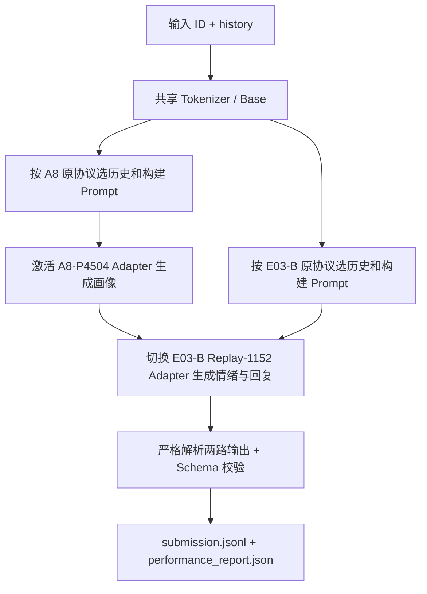
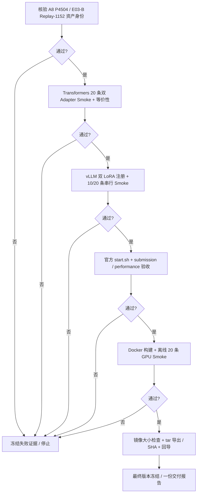

# E03 最终交付：A8 P4504 + E03-B Replay-1152 双 Adapter 集成、vLLM 与 Docker 验收方案

> **任务性质**：Codex 可直接执行的一次性交付任务。按门禁依次完成 Transformers 集成 Smoke → vLLM 双 LoRA Smoke → 官方入口验收 → Docker 离线验收及镜像导出。前一阶段未通过则保留证据并停止，不跳过门禁、不暗中降级为旧模型。
>
> **训练边界**：不再训练、不改两份原始 Adapter、不改 Prompt 内容、不试新模型。所有正式结果均来自冻结的 **A8 P4504** 与 **E03-B Replay-1152**。

## 一、目标、分支与冻结资产

### 1. 最终功能

对每个官方输入样本 `{"id":...,"history":[...]}`，使用一份 `Qwen3-1.7B` Base 和两份 LoRA，**串行**执行两次生成：

1. **A8 P4504（画像）**：以原生 A8 Prompt 生成 `Personality=...\nInterests=...\nStyle=...`。
2. **E03-B Replay-1152（情绪+回复）**：以原生 E03-B Prompt 生成 `emotion=<标签>;response=<回复正文>`。
3. 解析并组装官方 `submission.jsonl`；写入官方 `performance_report.json`，保持 `bash /root/participant/start.sh TEST_FILE RESULT_DIR` 的固定接口。

每个样本原始 `id` 原样回填；`user_profile` 来自 A8；`emotion_label` 与 `response_text` 来自 E03-B；`memory_refs=[]`。不混合两组 LoRA 权重，不用模型再次重写融合结果。



### 2. 代码来源

- 在 `feat/e01-b-traindev-val` 的成果上新建 `feat/final-dual-adapter-delivery`；启动时记录真实 Git HEAD 与工作区状态。
- 从 `chore/e03-b-p2-twofield` 引入 `configs/prompts/p_e03b.txt`、必要的 E03-B 推理协议与报告身份。**按文件有选择地引入**，不要整体覆盖既有 `participant/`、`src/shared/` 与 E01-B/A8 代码。
- 保留 E01-B 单模型推理模式与 E02 Docker 旧文件可用；新功能使用独立配置和独立集成文件，官方入口只增加模式分发。

### 3. 现有本地模型目录（以文件为准）

用户已将两个候选放在同一目录层级：

```text
<CANDIDATES_ROOT>/
├── A8-P4504/
│   ├── adapter/
│   │   ├── adapter_config.json
│   │   └── adapter_model.safetensors
│   ├── checkpoint-0456/
│   ├── source_manifest.json
│   └── SHA256SUMS.txt
└── A8-ER/
    ├── adapter/
    │   ├── adapter_config.json
    │   └── adapter_model.safetensors
    └── checkpoint-1152/   # E03-B Replay-1152；以实际完整目录名核对
```

优先使用 `outputs/final_candidates` 作为 `<CANDIDATES_ROOT>`；如果资产被放在其他位置，则读取 `configs/deployment/final_dual.yaml` 中的 `candidates_root`，不要复制模型到临时目录后依赖隐式路径。用户已经明确最终 E03-B 选择是 **1152**，不使用 1154、1792、2219 或 4665 作为正式集成模型。

**预检必须检查**：

- 两份 `adapter_model.safetensors` / `adapter_config.json` 的存在性、SHA-256、可加载性；保存独立 `model_lock.json`，记录**当前实物** Hash。A8 对照已有归档 Manifest；E03-B 对照仓库 Replay-1152 实验记录和本地 `checkpoint-1152/trainer_state.json`、保存日期、权重来源；不能靠文件夹名称认定训练阶段。若记录中只有 replay-local step，则核对其确实来自 4665 后的 1152 步，而非直接要求 `global_step=1152`。
- Base 使用仓库锁定 `Qwen/Qwen3-1.7B` revision `70d244cc86ccca08cf5af4e1e306ecf908b1ad5e`，权重身份 `005d20550c04f4e246e5b434448786b44a0196b47d758d0acc77aba279e5bbc5`；两套 LoRA 必须兼容相同 Base、Tokenizer、Chat Template、七个 target modules、`r=8`、`alpha=16`，确认未增加训练词表或新增 special token。
- 训练 Checkpoint 只作溯源与归档，**不加载** `optimizer.pt`、`scheduler.pt`、`rng_state.pth` 执行推理。
- 一律只读原始资产。若 E03-B `adapter_config.json` 内 `base_model_name_or_path` 指向队友的旧机器目录，先核对实际 Base 和 PEFT 兼容性；如需改为本机路径，只在**部署副本**中修订并重新记录 Hash，原件保持不变。
- `model_lock.json` 同时记录两套 Prompt 的 SHA、Tokenizer Signature、Chat Template、LoRA 权重/配置 SHA、Base SHA 和生成参数；后续所有阶段只消费这个锁定身份，不允许自动重新选档。

## 二、阶段 A：Transformers 双 Adapter 集成并进行小样本验收

### 1. 需要实现的模块

建议新增如下最小文件，命名可按仓库现行规范调整，但职责不可省略：

| 文件 | 职责 |
|---|---|
| `configs/deployment/final_dual.yaml` | 模型路径、Prompt 路径、两套生成上限、Server 别名、门禁及身份 Hash |
| `src/inference/final_dual_protocol.py` | A8 / E03-B 各自的 Prompt 构造、严格解析和官方 JSON 组装 |
| `src/inference/final_dual_runtime.py` | 单 Base 双 LoRA 的 Transformers 运行时与两路生成调用 |
| `participant/final_dual_inference.py` | 可被 `start.sh` 调用的官方双路 JSONL 运行入口；兼容 Transformers 和 vLLM 后端 |
| `scripts/final_dual_smoke.py` | 冻结测试样本、独立推理对照、双路 Smoke 和报告 |
| `tests/test_final_dual_protocol.py` | A8/ER 解析、历史、失败降级、Schema 与 ID 测试 |
| `tests/test_final_dual_runtime.py` | 双 Adapter 切换、模型身份、路由及模拟 API 测试 |

已有 `participant/run_inference.py` 中的 Tokenizer、Adapter 加载、官方 Schema、JSONL 输出、性能报告、Resume 和哈希能力优先复用；新模式的路由逻辑单独封装，不在旧单模型主循环里复制一整套代码。

### 2. 两套 Prompt 与历史选择必须与已训练模型一致

**A8：**

- 实际画像指令：`configs/prompts/p_a8_v2_profile.txt`，Hash 与 A8 配置锁一致。
- 先用 `configs/prompts/p0.txt` 按 T1 做最近完整历史裁剪，再运行 A8 现有 `select_common_history()`，提供 **P 与 EP 两份原 Prompt**，以共同预算构建 A8-P 的消息和 Token IDs。即便部署时不使用 EP Adapter，也要保留 `p_a8_v2_emotion_profile.txt` 作为 A8 历史预算计算的依赖。
- `max_prompt_tokens=1280`、Greedy、`max_new_tokens=256`、Qwen thinking 关闭；使用 `src/shared/e03_a8_protocol.py::parse_specialist_output(..., arm="P")` 严格解析三个字段，`-` 转为空列表。

**E03-B：**

- 实际指令：`configs/prompts/p_e03b.txt`，与队友选定的 Replay-1152 原版相同，不新增或润色 Prompt。
- **按 E03-B 训练/`infer_209.py` 口径**：先以 P0 + T1 选择历史，再将所选消息用 E03-B Prompt 构造最终消息并编码。仓库 `scripts/e03b/infer_test.py` 曾直接使用 E03-B Prompt 做 T1 选择，本次不要沿用这处不一致。记录选取的消息 ID/起点及 Prompt Token ID Hash。
- 若换成 E03-B Prompt 后超过 1280 Token，遵循 T1 的完整消息裁剪规则继续去除最旧历史并记录，不做任意 token 切片；若最后一条用户消息本身无法容纳，则记录该样本失败，不伪造输入。
- Greedy、`max_new_tokens=1200`、thinking 关闭；用**第一个** `;response=` 拆分 `emotion=...;response=...`，正文中的分号、换行和其他内容保持原样。情绪只接受官方 16 个标签；空回复或非法情绪作为对应字段错误，不影响 A8 已有效画像。

两路输入都不得包含 Gold、样本的目标字段或跨会话状态。两路可以共享原始 `history`，但保留各自经过训练验证的历史裁剪结果。

### 3. 单 Base + 双 LoRA 实现

```python
base = load_verified_qwen_nf4_once()
model = PeftModel.from_pretrained(base, p_adapter, adapter_name="profile", ...)
model.load_adapter(er_adapter, adapter_name="emotion_response", ...)
model.eval()

for sample in samples:
    p_ids = build_frozen_a8_p_prompt_ids(sample)
    er_ids = build_frozen_e03b_prompt_ids(sample)
    with torch.inference_mode():
        model.set_adapter("profile")
        p_text, p_tokens = generate(model, p_ids, max_new_tokens=256, do_sample=False)
        model.set_adapter("emotion_response")
        er_text, er_tokens = generate(model, er_ids, max_new_tokens=1200, do_sample=False)
    submission = assemble_and_validate(sample["id"], p_text, er_text)
    write_prediction_and_per_sample_diagnostics(submission)
```

实现中按训练配置正确处理 NF4 / BF16、`prepare_model_for_kbit_training()` 和 PEFT Adapter autocast。加载/切换/生成均用显式 Adapter 名称，不对同一模型实例并发调用 `set_adapter()`。关闭训练态与 Gradient Checkpointing，开启 KV Cache。

**加载等价门禁**：固定 5–20 个输入，分别用两套 Adapter **单独加载**运行一次，再用共享 Base / 双 Adapter **交替切换**运行；各自输入 Token IDs 和 Greedy 输出 Token IDs 必须逐项相同，再重复切换一次验证无串线。若不一致，检查基座量化方式、非量化权重 dtype、Adapter 自动转换、Tokenizer 与缓存，不能为了通过而修改 Prompt 或 Gold。

### 4. 小范围真实样本及验收

- 固定 **20 条**样本，尽可能覆盖多轮历史、长历史、空/非空画像、多情绪与中英文；如果仓库 `test_inference_data.jsonl` 数量不足，从已冻结的 target-free Val 提取补足，并在官方入口验证时使用符合 `test_XXXXXX_tN` 正则的**独立测试 ID 映射**，保存映射，绝不改内容或读取 Gold 参与生成。
- 冻结 `smoke20_input.jsonl`、样本 ID/会话映射与 SHA-256；先生成、冻结预测，再读取本地合法 Gold（如有）计算分项指标。20 条结果用于工程验收，不据此宣布最终 F1。
- 每条保留两个原始输出、解析结果、失败类型、两路 Token 数、单路/总耗时及显存峰值；严格保证 `submission.jsonl` 恰好 20 条、每个 ID 对应唯一输入、官方 Schema **20/20** 合法。
- 两路格式严格解析分别达到 **≥19/20**；非空回复正常、不得整段丢失；单路失败需保留另一半结果，`memory_refs=[]`，禁止生成不存在的 `mem_` 引用。
- 对有 Gold 的小样本报告三维 TP/FP/FN、情绪命中数与回复长度，不用小样本波动作为强制 F1 决策门槛。
- 未通过身份、独立/切换等价性或 Schema 门禁则**停止后续所有阶段**，留下详细失败清单及原始输出。

## 三、阶段 B：vLLM 0.11.1 单服务、双 LoRA 串行调用

小样本 Transformers 通过后再启动，不重新训练模型。

### 1. 服务方式

复用 E02 已验证的 vLLM 0.11.1 服务环境（同一 Qwen Base），启动时**同时注册两个 LoRA**，请求时由 `model` 字段选择对应 Adapter。示意：

```bash
vllm serve /absolute/path/to/participant/model \
  --host 127.0.0.1 --port 8000 \
  --served-model-name qwen-base \
  --enable-lora \
  --lora-modules profile=/absolute/path/to/A8-P4504/adapter \
                 emotion-response=/absolute/path/to/A8-ER/adapter \
  --max-lora-rank 8 --max-loras 1 --max-cpu-loras 2 \
  --max-model-len 2560 --max-num-seqs 1 \
  --gpu-memory-utilization 0.8
```

实际脚本从锁定配置解析路径，不硬编码这些示意目录。串行模式仅有一个请求在执行，`max-loras=1` 表示单批至多激活一个 LoRA，两个 LoRA 可以同时注册；`max-cpu-loras=2` 保留两份 LoRA 的存储能力。允许在真实 GPU 上据显存调低利用率，但必须保存实际参数和测试结果，不得删掉任意 Adapter。根据官方 vLLM 0.11.1 LoRA 文档支持 `--lora-modules name=path ...` 和对应模型路由。

### 2. 客户端请求与协议对齐

- `GET /v1/models` 应同时出现 `profile`、`emotion-response`；只看到 Base 或一个 Adapter 不可放行。
- 对同一条样本，串行发出两次 `chat/completions`：`model="profile"` 和 `model="emotion-response"`，分别使用已冻结的原生 Prompt 和历史，`chat_template_kwargs.enable_thinking=false`、`temperature=0` / Greedy 口径（具体兼容参数以 vLLM 0.11.1 接口为准）。
- 保持与本地 Transformers 构造的 Qwen Chat Template 一致；按照仓库 E02 的方法检查两路实际 Prompt Token IDs 的准确匹配，不把“请求消息看起来一样”当成协议等价。
- **不要强求 vLLM 与本地 NF4 的生成 Token 逐位一致**：E02 vLLM 用 BF16 Base，数值路径可能不同；必须分别记录模型输出、严格格式率、情绪/画像指标、生成长度和延迟。若 BF16 与 NF4 的小样本结果差异很大，诊断权重、模板、KV Cache 和量化后，再决定是否放行。
- 先运行固定 **10 条** vLLM Smoke，再运行上述 **20 条**相同输入。输出仍需 100% Schema 合法、双路正确注册且被调用、无 OOM/崩溃/静默退化，格式通过率保持 ≥95%。
- 记录初始化耗时、GPU 峰值、A8 分路耗时、E03-B 分路耗时、总耗时 P50/P95、生成 Token 量；双路延迟按整条输入从构造到最终输出计时，不用单模型前缀生成耗时冒充端到端成本。

**阻断条件**：服务显存不足、任一 Adapter 无法注册、模型 alias 路由不一致、无法证实两路 Prompt 正确、格式率显著崩坏。保留日志，禁止自动改回单 Adapter 并报告双路成功。

## 四、阶段 C：官方固定脚本与完整输出契约验收

完成 vLLM Smoke 后，保持以下官方调用方式不变：

```bash
bash /root/participant/start.sh TEST_FILE RESULT_DIR
```

本地仓库对应：`bash participant/start.sh TEST_FILE RESULT_DIR`。

### 具体修改

1. `participant/start.sh` 读取 `EVALUATION_INFERENCE_CONFIG` 指定的独立双路配置，增加 `dual_adapter` 启动分支：启动 vLLM 时注册两份 LoRA、校验 `/v1/models` 双别名和资产 SHA，再调用 `participant/final_dual_inference.py`；默认单路配置仍走既有实现。官方 CLI 始终只有两个位置参数。
2. `participant/final_dual_inference.py` 对所有输入逐条进行双路生成、解析及完整 Schema 校验，写入 `submission.jsonl`；`performance_report.json` 记录前 100 条**双路完整端到端**时间、设备、初始化信息、两个 Adapter 身份、每路失败数与总数。
3. 容错规则：单路格式异常只清空该路负责的输出；生成成功的另一部分不得被覆盖。A8 失败 → 三维画像空数组；E03-B 情绪失败 → `emotion_label=""`，回复若能可靠独立解析则保留；E03-B 回复失败 → `response_text=""` 并记失败。全部字段须始终存在。
4. 使用独立的新结果目录，禁止覆盖已冻结的 A8 / Replay / E01-B 推理结果；支持原运行器的逐行身份、顺序、故障与 Resume 语义，并增加双 Adapter 锁定身份校验。
5. 使用固定 `test_...` 格式的 **10–20 条**输入执行真实 `start.sh`，严格检查官方 `submission_schema.json`、数量、唯一 ID、字段来源、性能报告、异常情形；再对前 100 条可用输入（如具备）做独立延迟基准，明确不要求提前完成 2,354 条 Val 全量评测。

**必须通过**：真实调用 `start.sh` 退出码为 0、输入 ID 全覆盖、Schema 合法率 100%、两份 Adapter 身份与路由正确、官方两个输出文件存在，且 `performance_report.json` 的测量范围真实反映两次模型生成。

## 五、阶段 D：Docker 封装、离线 GPU Smoke、镜像导出

在阶段 C 通过后执行；优先复用 E02 已经成功的 CUDA 12.8 / PyTorch 2.9.0+cu128 / vLLM 0.11.1 / Conda `conda_env` 运行环境及 GPU Smoke 经验。

### 1. 独立构建内容

建议新建 `docker/final_dual/`（`Dockerfile`、`entrypoint.sh`、README）和 `scripts/final_dual_docker_package.py`，不修改或覆盖历史 `docker/e02/` 的已验收包。复用旧版 Docker 的环境锁、显存预检、输出验证与哈希算法。

最终镜像必须带上：

```text
/root/
├── participant/
│   ├── start.sh
│   ├── final_dual_inference.py
│   ├── run_inference.py
│   ├── templates/submission_schema.json
│   ├── model/                    # 唯一 Qwen3-1.7B Base + Tokenizer
│   └── adapters/
│       ├── profile/             # A8 P4504 adapter 目录
│       └── emotion-response/    # E03-B replay-1152 adapter 目录
├── configs/
│   ├── deployment/final_dual_docker.json
│   └── prompts/
│       ├── p0.txt
│       ├── p_a8_v2_profile.txt
│       ├── p_a8_v2_emotion_profile.txt
│       └── p_e03b.txt
├── src/shared/                 # 输入历史与 Chat Template
├── src/inference/              # 双路解析、运行及组装
├── scripts/                    # 启动 / vLLM 证据验证辅助
└── model_lock.json             # 双 Adapter + Base + Prompt 身份
```

如 `src/inference` 依赖 A8 解析器，则也必须包含 `src/shared/e03_a8_protocol.py` 与相应依赖。Docker Context 采用白名单复制，不包括 `optimizer.pt`、`scheduler.pt`、训练数据、Val Gold、Cache、Git 历史和非最终模型。所有大模型文件保存在 Docker Build Context 的忽略目录中，不提交 Git。

### 2. 正式 Docker 运行方式

- Docker 内 `conda_env` 已创建，`start.sh` 可直接运行；`Dockerfile` 的 EntryPoint 仅把 `TEST_FILE RESULT_DIR` 转交 `bash /root/participant/start.sh`。
- 不依赖宿主机 Python、宿主 HF Cache 或外部网络；服务仅监听容器 loopback。
- 使用 NVIDIA GPU 启动并显式验收两份 LoRA 的 `/v1/models` 注册结果、单 Base 事实、实际请求模型 ID、输出和异常日志。

建议命令形态：

```bash
# 以下为新交付工具需支持的接口，Codex 实现后实际执行
python scripts/final_dual_docker_package.py check
python scripts/final_dual_docker_package.py prepare --config configs/deployment/final_dual.yaml \
  --output-dir outputs/deployment/final_dual/context

docker build -f docker/final_dual/Dockerfile -t emotioncompany/final-dual:validated \
  outputs/deployment/final_dual/context

docker run --rm --gpus all --network none --shm-size 1g \
  -v "$PWD/outputs/evaluation/final_dual/smoke20_input.jsonl:/input/smoke.jsonl:ro" \
  -v "$PWD/outputs/deployment/final_dual/docker-smoke:/output:rw" \
  emotioncompany/final-dual:validated /input/smoke.jsonl /output

python scripts/final_dual_docker_package.py verify-output \
  --test-file outputs/evaluation/final_dual/smoke20_input.jsonl \
  --result-dir outputs/deployment/final_dual/docker-smoke
```

验收 `submission.jsonl` 20/20 官方 Schema 合法、`performance_report.json` 有效、容器完全离线、GPU 真实使用、双别名均参与请求、无 OOM。与宿主 vLLM 使用相同 Base/Adapter/Prompt 时，固定样本的输出和解析指标应一致；若不一致，定位镜像内模型/依赖/采样配置身份，停止交付。

### 3. 镜像体积、导出和回导验证

- `docker image inspect` 记录镜像虚拟大小，采取保守的 **50,000,000,000 bytes** 上限；超出则清理无关依赖或构建缓存，并重新验收，不删除模型或关键 Runtime 文件。
- `docker save` 导出镜像 tar，生成 SHA-256；`docker load` 在可用的隔离环境中回导后再运行一轮 GPU Smoke，确认镜像可迁移。如无独立环境，至少执行本机 `docker load` 回导和离线 Smoke，准确注明验证级别。
- 保存最终镜像 tar、SHA 文件、Dockerfile Hash、`model_lock.json`、启动日志、双路 GPU 性能与输出校验报告。Docker 与模型均不提交 Git；Git 中仅提交脚本、配置（不含本机绝对路径/模型文件）和汇总报告。

## 六、全流程一次性执行与停止规则

实现一个顶层 `scripts/final_dual_delivery.py` 或等价任务入口，按固定顺序调用以下阶段。允许本次自动执行到 Docker 完成，**无需每个阶段再请示**；任一硬门禁失败必须保留当前阶段产物并停止，不能继续伪造后续 passed。



建议总输出树：

```text
outputs/final_delivery/<RUN_ID>/
├── model_lock.json
├── asset_preflight.json
├── transformers_smoke20/{input,predictions,raw,metrics,manifest}.json*
├── vllm_smoke/{server_log,models,outputs,metrics,manifest}.*
├── official_runner/{submission.jsonl,performance_report.json,verify.json}
├── docker/{build.log,image_info.json,docker-smoke/,image.tar,image.tar.sha256}
├── gate_ledger.jsonl
└── final_acceptance.json
```

`gate_ledger.jsonl` 每阶段记录 `status=passed|failed|not_run`、模型 SHA、Prompt SHA、代码 Git SHA、输入样本 SHA、命令、耗时、显存、失败原因和产物 Hash。已存在 Run 不允许覆盖；中断续跑需验证此前每个阶段的 SHA、模型配置和数据身份，不能直接信任旧的 `passed` 文本。

## 七、最终交付与验收条件

Codex 在新分支中提交：

1. 双 Adapter 推理实现、两份 Prompt 和锁定配置、原始协议复用、自动化测试。
2. vLLM 双 LoRA 启动/请求支持、官方 `start.sh` 保持两参数接口、官方输出验证。
3. Docker 双模型白名单打包、离线 GPU Smoke、镜像体积与 tar 导出/回导工具。
4. `docs/experiments/E03_双Adapter最终集成与Docker验收.md`：**填写实际执行结果**，包括两路严格格式、20 条输出、等价性、峰值显存、逐路及整条延迟、Schema 通过数、两份 Adapter SHA、vLLM 和 Docker 结果；附最小复现命令。
5. 执行 `python -m compileall -q scripts src participant tests`、`git diff --check`、新增单测、已有推理协议和 Docker CPU 回归、真实 GPU 测试，并提供每条命令的实际退出状态。

**最终通过定义**：20 条 Transformers 双路正常、两 Adapter 切换等价；vLLM 可同时注册且串行调用两份 Adapter；官方 `start.sh` 完整生成两个要求文件；Docker 离线 GPU 生成同样合规的官方 JSON；镜像和所有模型均能按锁定 SHA 恢复。**除非上述条件全部满足，不得把工程状态记为 `ready_for_submission`。**

通过后冻结此版本，保留 A8 P4504、E03-B Replay-1152 与 E01-B TrainDev4504 三份已有模型资产。不再开展微调、Replay 或 Prompt 搜索；正式赛事提交另按次数预算进行。
